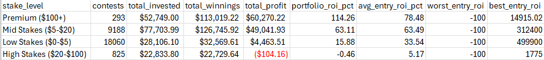
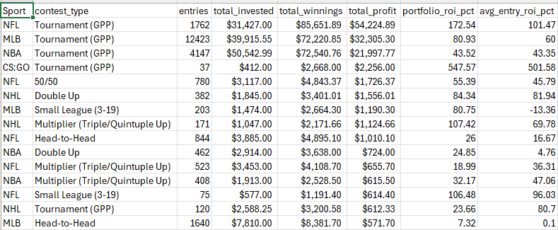
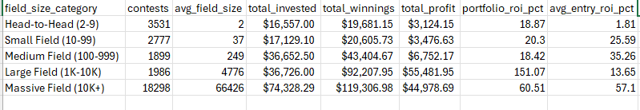

# Daily Fantasy Sports Performance Analysis: SQL Portfolio Project

**Analyzing 28,491 DFS contests resulting in $113,813 profit (62.74% ROI)**

## Project Overview

Over 5+ years (2015-2021), I competed in daily fantasy sports on DraftKings across multiple sports. This SQL project analyzes my complete contest history to uncover performance patterns, optimal strategies, and ROI drivers.

## Business Question

**How can systematic analysis of 28,491 competitive decisions identify what drove profitability and inform strategic resource allocation?**

This mirrors real business analytics scenarios: customer behavior analysis, marketing campaign effectiveness, product performance across thousands of transactions.

## Data Source

- **Platform:** DraftKings contest export
- **Records:** 28,491 contest entries
- **Time Period:** September 2015 - February 2021
- **Sports:** NBA, NFL, MLB, NHL, CS:GO, and 8 others
- **Metrics:** Entry fees, winnings, field sizes, finish positions, contest types

## Technical Implementation

**Database:** Microsoft SQL Server  
**Tool:** SQL Server Management Studio (SSMS)  
**Integration:** Ready for Power BI connection (next phase)

**Key Skills Demonstrated:**
- Database creation and table design
- Data import and type conversion
- Calculated columns (total_winnings, profit, roi_pct)
- Aggregate functions (SUM, AVG, COUNT, MIN, MAX)
- GROUP BY and HAVING clauses
- CASE statements for categorization
- Window functions (cumulative calculations, ROWS BETWEEN)
- CTEs (Common Table Expressions)
- Date functions (FORMAT, YEAR, CAST)
- TOP N queries
- LIKE pattern matching
- NULL handling (NULLIF, ISNULL)

## Key Findings

### Overall Performance
- **Total Contests:** 28,491
- **Total Invested:** $181,392.89
- **Total Winnings:** $295,206.48
- **Net Profit:** $113,813.59
- **ROI:** 62.74% (portfolio ROI: total winnings ÷ total entry fees − 1)
- **Profit Rate:** 35.80% (10,199 entries returned more than their entry fee)
- **Placement Rate:** 47.75% (entries that cashed or finished top 100)

### Sport-Specific Performance
- **NFL:** 127.56% ROI ($57,281 profit) - 50% of total profit from one sport
- **MLB:** 62.96% ROI ($34,172 profit) - High-volume workhorse
- **NBA:** 38.01% ROI ($23,066 profit) - Consistent performer
- **NHL:** 54.23% ROI with 62.93% win rate - Underexploited opportunity

### Strategic Insights

**Stake Level Optimization** (portfolio ROI):
- Premium ($100+): 114.26% ROI, $60,270 profit from only 1% of volume
- Mid-stakes ($5-$20): 63.11% ROI, $49,042 profit across 32% of volume
- Low-stakes ($0-$5): 15.88% ROI across 63% of volume
- High-stakes ($20-$100): -0.46% ROI (-$104) - the only losing tier



**Contest Type Performance** (portfolio ROI):
- Tournaments (GPPs) produced about 98% of total profit: NFL 172.54% ROI ($54,225), MLB 80.93% ($32,305), NBA 43.52% ($21,998)
- Cash games (50/50s, Double Ups, Triple/Quintuple Ups, head-to-heads) were near break-even, each line earning under $1,800
- Head-to-head: 7.32% ROI in MLB (1,640 entries), 26.00% in NFL (844 entries)



**Field Size Performance** (portfolio ROI):
- Large fields (1K-10K players): 151.07% ROI, $55,482 profit - 49% of total profit from 7% of volume
- Massive fields (10K+ players): 60.51% ROI, $44,979 profit across 64% of volume
- Small and medium fields (10-999 players): 18-20% ROI
- Head-to-head (2-9 players): 18.87% ROI, $3,124 profit across 12% of volume



**Win Distribution:**
- **7.68% first-place finish rate** (2,187 entries; includes head-to-head and small-league wins)
- 80% of total profit from first-place finishes alone
- Top-3 finish rate: 14.28%

**Year-over-Year Evolution:**
- 2015-2017: Learning phase (-$478 total)
- 2018: Breakthrough (57.25% ROI, $34,756 profit)
- 2019: Peak performance (104.92% ROI, $86,297 profit)
- 2020: Market deterioration (-19.33% ROI) - disciplined exit

## SQL Queries

This project includes 10 analytical queries demonstrating:

1. **Overall Performance Summary** - Aggregate analysis across all contests
2. **Performance by Sport** - Profitability segmentation by sport
3. **Performance by Entry Fee Tier** - ROI analysis across stake levels
4. **Performance by Field Size** - Tournament size impact on profitability
5. **Top 20 Biggest Wins** - High-impact results analysis
6. **Monthly Performance Trend** - Time-series profitability tracking
7. **Best Performing Contest Types** - Multi-entry vs. single-entry analysis
8. **Win Distribution Analysis** - Finish position frequency and profitability
9. **Year-over-Year Performance** - Annual progression and scaling patterns
10. **Cumulative Profit Over Time** - Running total with ROI tracking

### Methodology Notes
**ROI.** All ROI figures in Key Findings are portfolio (dollar-weighted) ROI: total winnings ÷ total entry fees − 1. Queries 3, 4 and 7 also report the average of per-entry ROI for comparison; that figure weights a $1 entry the same as a $333 entry and is not used for conclusions.

**Contest types.** Query 7 classifies each entry by structure first (field size of 2 = head-to-head), then by name keywords (Double Up, 50/50 or 50-50, Triple/Quintuple Up), then by tournament markers (payout tags, entry limits, or 100+ entries). This leaves 80 entries (0.28%) unclassified. See [DATA_DICTIONARY.md](DATA_DICTIONARY.md).

MME (Mass Multi-Entry) tournament strategy intentionally distributes 
entries across lineup variations, meaning a percentage of non-cashing 
entries is built into the expected value model — not a performance flaw. 
Sports with negative ROI (Soccer, Tennis, iRacing) represent deliberate 
small-sample market tests that were discontinued after failing to show 
exploitable edge. This is reflected in Key Business Lesson #1: 
Specialization > Diversification.

[View all queries →](dfs_analysis_queries.sql)

## Business Applications

The analytical techniques used here apply directly to:

- **Customer Segmentation:** Analyzing 28K contests = analyzing customer transactions
- **Product Performance:** Evaluating contest types = product line optimization
- **Pricing Strategy:** Entry fee optimization = pricing tier analysis  
- **Marketing ROI:** Tournament selection = campaign performance measurement
- **Resource Allocation:** Sport selection = channel investment optimization
- **Lifecycle Analysis:** Year-over-year trends = customer/product lifecycle

## Key Business Lessons

### 1. Specialization > Diversification
96% of profit came from 4 core sports (NFL, MLB, NBA, NHL) while 9 experimental sports generated cumulative losses of $6,420. By contest type, tournaments produced about 98% of profit while cash games were near break-even.

### 2. Asymmetric Upside Strategy
Optimizing for "win rate" (7.68% first-place finishes) rather than "cash rate" created 2.17x return ratio where big wins more than covered frequent small losses.

### 3. Aggressive Scaling When Edge Confirmed
Upon breakthrough in 2018, volume increased 12x (629 → 7,623 contests) and capital deployment increased 36x, generating 104.92% ROI in 2019.

### 4. Disciplined Exit When Conditions Change
After COVID disrupted market in 2020, systematic testing (2,975 contests) confirmed edge had disappeared. Executed exit preserving 95% of peak profit rather than chasing past performance.

## Repository Structure
```
dfs-performance-sql-analysis/
├── README.md                  # This file
├── DATA_DICTIONARY.md         # Fields, metric definitions, query-to-field map
├── dfs_analysis_queries.sql   # All 10 analytical queries
├── queryN_*.png               # Query result screenshots
└── queryN_results.xlsx        # Query result exports
```

## Next Steps

1. **Power BI Dashboard** - Visualize performance trends and key metrics
2. **Predictive Modeling** - Build Python/R models for contest selection optimization
3. **Cohort Analysis** - Analyze performance evolution and learning curves

## Tools Used

- **Microsoft SQL Server** - Database management
- **SQL Server Management Studio (SSMS)** - Query development and execution
- **Excel** - Results export and validation
- **Markdown** - Documentation

## Contact

Mark Peterson  
mpeter8907@gmail.com  
[GitHub](https://github.com/mpeter70) | [LinkedIn](https://www.linkedin.com/in/mark-peterson-76189a98/) | [Portfolio](https://mpeter70.github.io)
