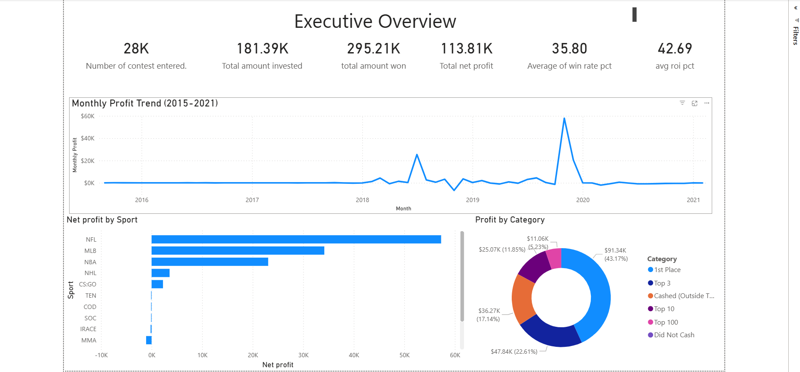
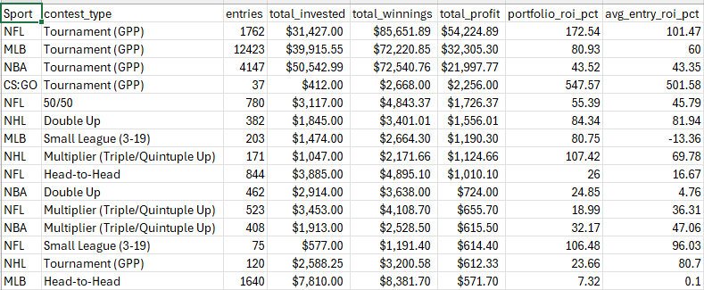
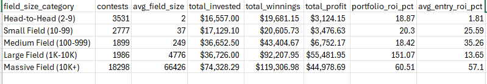
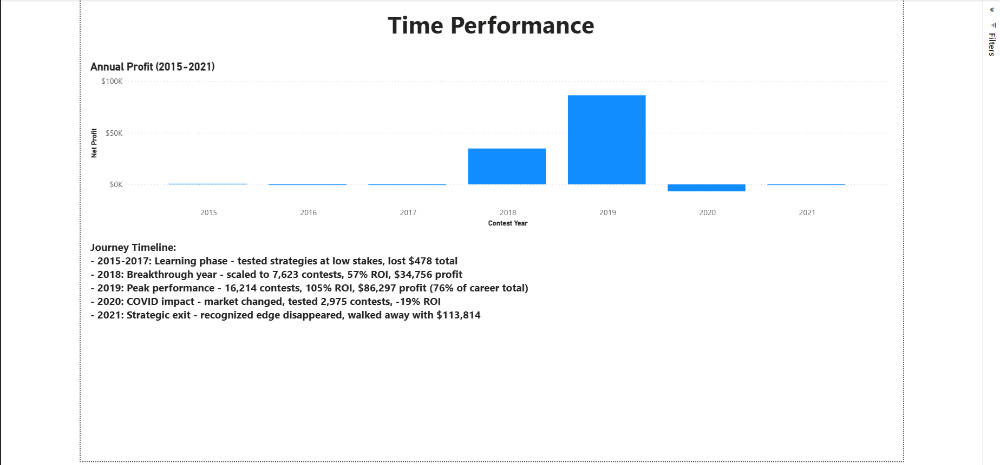

# What Drove $113K in Daily Fantasy Sports Profit: An Analysis of 28,491 Contest Entries

**Mark Peterson · SQL Server · Power BI · Excel**

## Summary

From September 2015 to February 2021 I entered 28,491 daily fantasy sports contests on DraftKings, risking $181,393 in entry fees for a net profit of $113,814 (62.74% portfolio ROI). This project loads that full history into SQL Server and asks one question: **where did the profit actually come from, and how much of it was repeatable?**

**Headline findings**

1. **Profit was extremely concentrated in time.** One month (November 2019) produced $57,964, or 51% of career net profit. The best three months produced 91%. In the other 61 months combined, ROI was 6.8%.
2. **Tournaments did all the work.** Large-field tournaments (GPPs) produced about 98% of profit. Cash games (50/50s, Double Ups, head-to-head) were close to break-even.
3. **First place is the business.** 7.68% of entries finished first, and those finishes account for 80% of net profit. 52% of entries won nothing.
4. **Specialization beat diversification.** Four sports (NFL, MLB, NBA, NHL) produced 104% of net profit. Eight other sports tested on small samples lost $6,523 combined.
5. **Mid-size fields had the best ROI.** Fields of 1,000-10,000 entries returned 151% on 7% of volume, more than double the ROI of 10,000+ fields.



## Data

| Item | Value |
|---|---|
| Source | DraftKings contest history export (CSV) |
| Grain | One row per contest entry |
| Rows | 28,491 |
| Period | 2015-09-13 to 2021-02-24 |
| Sports | 13 |
| Fields used | Contest name, sport, date, entry fee, finish position, field size, winnings |

Full field definitions are in [DATA_DICTIONARY.md](DATA_DICTIONARY.md).

## Method

**ROI is dollar-weighted.** Every ROI figure in this report is portfolio ROI: total winnings ÷ total entry fees − 1. The simple average of per-entry ROI (42.69%) is reported in the queries for comparison only, because it weights a $1 entry the same as a $333 entry.

**Contest types are classified by rule, in order.** Query 7 assigns each entry to the first rule it matches: field size of 2 = head-to-head; then name keywords (Double Up, 50/50 or 50-50, Triple/Quintuple Up); then fewer than 20 entries = small league; then tournament markers (payout tags, entry limits, or 100+ entries). 80 entries (0.28%) match no rule and are left as "Other". An earlier name-only version left about 90% unclassified because DraftKings brands its tournaments (Wildcat, Splash, Big Jam) instead of labeling them.

**Small samples are flagged, not headlined.** Contest-type groups with fewer than 10 entries are excluded from Query 7. Sports with fewer than 100 entries (CS:GO, Call of Duty, iRacing, Soccer, Tennis) are reported but not used for conclusions. CS:GO's 548% ROI comes from 37 entries.

**Concentration was checked directly.** Monthly profit (Query 6) was ranked to test how much of the result depends on a few outlier months.

## Findings

### 1. A few months carried the career

| | Months | Net profit | Share of profit |
|---|---|---|---|
| Nov 2019 | 1 | $57,964 | 51% |
| Jul 2018 | 1 | $25,342 | 22% |
| Dec 2019 | 1 | $20,489 | 18% |
| All other months | 61 | $10,018 | 9% |

28 of 64 months were profitable. Excluding the top three months, the remaining $147K in entry fees returned 6.8%. A tournament strategy has this shape: long stretches near break-even, paid for by rare large wins. The lesson for any ROI analysis is that the average hides the distribution. A report built on the 62.74% figure alone would overstate how repeatable the edge was.

### 2. Tournaments produced about 98% of profit

| Sport | Contest type | Entries | Profit | ROI |
|---|---|---|---|---|
| NFL | Tournament | 1,762 | $54,225 | 172.5% |
| MLB | Tournament | 12,423 | $32,305 | 80.9% |
| NBA | Tournament | 4,147 | $21,998 | 43.5% |
| NFL | Head-to-head | 844 | $1,010 | 26.0% |
| MLB | Head-to-head | 1,640 | $572 | 7.3% |

No cash-game line earned more than $1,800.



### 3. First-place finishes were 80% of profit

| Finish | Share of entries | Net profit |
|---|---|---|
| 1st place | 7.68% | $91,340 |
| 2nd-3rd | 6.60% | $47,837 |
| 4th-10th | 3.81% | $25,069 |
| 11th-100th | 9.59% | $11,061 |
| Cashed outside top 100 | 20.07% | $36,274 |
| Did not cash | 52.25% | −$97,766 |

Paying finishes returned $2.16 for every $1 lost on non-cashing entries. The 7.68% first-place rate includes head-to-head contests, where first place is close to a coin flip, so it should not be compared with large-field win rates.

### 4. Four sports, then a disciplined stop

| Sport | Entries | Profit | ROI |
|---|---|---|---|
| NFL | 4,251 | $57,281 | 127.6% |
| MLB | 15,352 | $34,172 | 63.0% |
| NBA | 6,518 | $23,066 | 38.0% |
| NHL | 901 | $3,562 | 54.2% |
| 8 losing sports | 1,432 | −$6,523 | — |

NFL alone produced half of net profit on 15% of entries. Golf, League of Legends, NASCAR and MMA were tested for 200-670 entries each and dropped after losing money.

### 5. Stake level and field size

| Entry fee | Entries | Profit | ROI |
|---|---|---|---|
| $100+ | 293 | $60,270 | 114.3% |
| $5-$20 | 9,188 | $49,042 | 63.1% |
| Under $5 | 18,060 | $4,464 | 15.9% |
| $20-$100 | 825 | −$104 | −0.5% |

| Field size | Entries | Profit | ROI |
|---|---|---|---|
| 1,000-10,000 | 1,986 | $55,482 | 151.1% |
| 10,000+ | 18,298 | $44,979 | 60.5% |
| 100-999 | 1,899 | $6,752 | 18.4% |
| 10-99 | 2,777 | $3,477 | 20.3% |
| 2-9 | 3,531 | $3,124 | 18.9% |

The $100+ tier is 293 entries, about 1% of volume. Its 114% ROI is real money but rests on a small sample.



### 6. Timeline

| Year | Entries | Profit | ROI |
|---|---|---|---|
| 2015-2017 | 1,668 | −$478 | — |
| 2018 | 7,623 | $34,756 | 57.3% |
| 2019 | 16,214 | $86,297 | 104.9% |
| 2020 | 2,975 | −$6,681 | −19.3% |
| 2021 | 11 | −$81 | — |

After three years of small-stakes testing, volume rose 12x in 2018 and entry fees 36x. In 2020 the edge disappeared. After 2,975 more entries confirmed it, I stopped, ending at 94% of peak cumulative profit.



## Limitations

- **One player, one platform.** Results reflect one strategy on DraftKings and are not a market benchmark.
- **Outlier dependence.** As Finding 1 shows, the headline ROI rests on three months. Any forward-looking estimate should use the 6.8% ex-outlier figure, or a median, not 62.74%.
- **No lineup-level data.** The export records contest entries, not the lineups behind them, so the analysis cannot separate player-selection skill from contest-selection skill.
- **Head-to-head inflates first-place counts** (see Finding 3).

## How this applies to business analysis

The same questions apply to any portfolio of spend: which channels, price tiers and segments return the money, how concentrated the return is, which tests to stop, and whether a headline average survives once the outliers are removed.

## Repository

```
├── README.md                  this report
├── DATA_DICTIONARY.md         fields, metric definitions, query-to-output map
├── dfs_analysis_queries.sql   the 10 SQL queries behind every number here
├── queryN_results.xlsx        exported results for each query
├── queryN_*.png               query result screenshots
└── executive-overview.png, strategy-analysis.png, time-performance.png   Power BI report pages
```

**SQL techniques used:** CTEs, window functions (running totals), rule-ordered CASE classification, LIKE pattern matching, GROUP BY / HAVING, date functions, NULLIF / ISNULL handling.

## Contact

Mark Peterson · mpeter8907@gmail.com · [LinkedIn](https://www.linkedin.com/in/mark-peterson-76189a98/) · [Portfolio](https://mpeter70.github.io)
